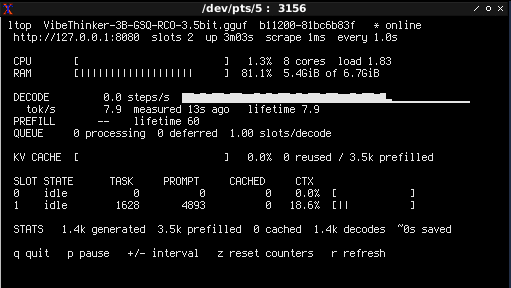

# ltop.c

A dependency-free, single-file POSIX C monitor for `llama.cpp`'s `llama-server` metrics. For linux.



## Philosophy

Modern software development has forgotten how to write a simple command-line utility. 

## Features

- **Zero Dependencies**: No `libcurl`, no `libcjson`, no `ncurses`, no Go runtime. 
- **Single File**: The entire program resides in one readable `ltop.c` file. No build systems, no Makefiles, no package managers.
- **Microscopic Footprint**: Compiles to a ~30KB statically optimizable binary in a fraction of a second.
- **Pure VT100**: Uses direct ANSI escape sequences for terminal control and rendering. No terminfo database lookups or heavy terminal libraries.
- **Scriptable**: Automatically detects non-interactive TTYs and outputs clean, space-separated key-value pairs suitable for `awk`, `grep`, or `prometheus-node-exporter` textfile collection.


## Technical Highlights

1. **Zero-Allocation JSON Parsing**: The `/slots` endpoint is parsed using a custom, depth-tracking state machine. It reads scalar values directly from the string buffer in a single pass without a single call to `malloc`.
2. **Raw POSIX Sockets**: HTTP/1.0 requests are constructed and sent via standard `socket()`, `connect()`, and `write()` calls. This eliminates the need for `libcurl` and its associated initialization overhead and hidden state.
3. **Deterministic UTF-8 Sparklines**: The decode speed sparkline exploits the fact that the Unicode block characters (`▁▂▃▄▅▆▇█`) are contiguous in the UTF-8 table and each is exactly 3 bytes. Rendering is achieved via direct pointer arithmetic (`memcpy(sp + k, ramp + 3 * g, 3)`), avoiding array-of-pointers indirection and ensuring maximum cache efficiency.
4. **Robust Terminal Handling**: Uses `poll(2)` with precise microsecond-aware timing for non-blocking input, ensuring the UI remains responsive without busy-waiting or spawning threads.

## Build

Ensure you have a standard C compiler (GCC or Clang) installed. No development packages beyond the standard C library are required.
```bash
cc -O2 -std=c99 -Wall -Wextra -o ltop ltop.c
```
## Usage

# Interactive mode (default when attached to a TTY)
```bash
./ltop
```

# Point to a specific host and port
```bash
./ltop http://192.168.1.50:8080
```

# Non-interactive mode: outputs a single snapshot for scripting
```bash
./ltop -1
```

# Non-interactive mode: outputs two snapshots, 2 seconds apart, to calculate rates
```bash
./ltop -1 -n 2
```

# Use an API key if your server requires authentication
```bash
./ltop -k your_secret_api_key
```

### Interactive Controls

When running in a terminal, the following keys are active:
- `q` or `Q`: Quit immediately.
- `p`: Pause/resume screen updates.
- `+` or `=`: Increase the polling interval.
- `-`: Decrease the polling interval (minimum 0.25s).
- `z`: Reset the baseline counters (useful for measuring a specific generation run).
- `r`: Force an immediate refresh.

## Design Constraints

- **No HTTPS**: This tool speaks raw HTTP/1.0. If your `llama-server` is behind a reverse proxy requiring HTTPS, use `stunnel`, `socat`, or `nginx` to terminate TLS locally, and point `ltop` at `http://127.0.0.1`. A monitoring tool should not be burdened with cryptographic library dependencies.
- **Linux-Centric Host Metrics**: CPU and RAM sampling read directly from `/proc/stat` and `/proc/meminfo`. On non-Linux POSIX systems, these specific lines will silently omit, while the core `llama-server` metrics will continue to function perfectly.
- **No Object-Oriented Patterns**: The code is strictly procedural. State is managed via explicit structs and global static variables where appropriate for a single-instance CLI tool, avoiding the abstraction overhead and indirection of OOP paradigms.

## License

MIT. Derived from the original pefman/ltop concept, but rewritten from the ground up to adhere to strict Unix engineering principles.

